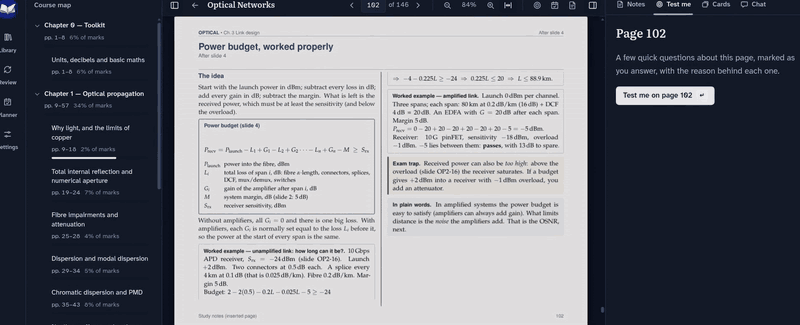
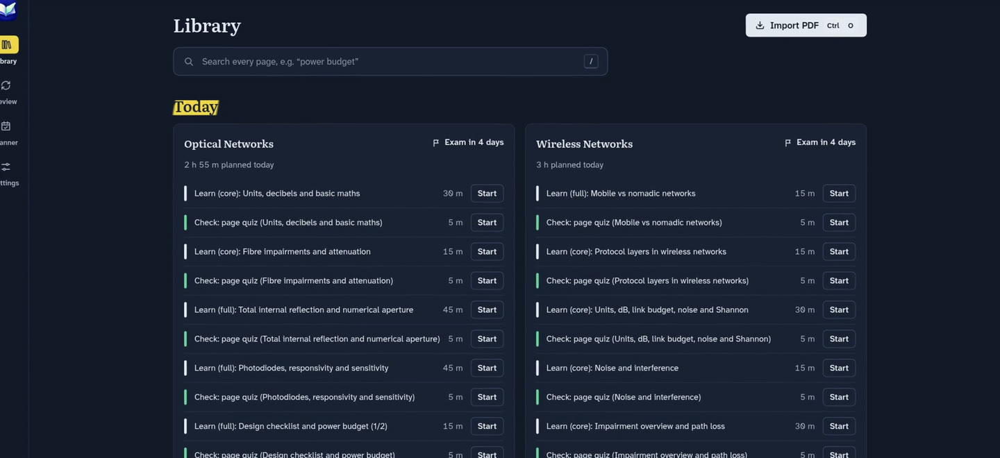
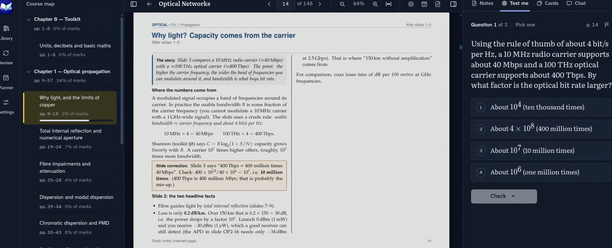
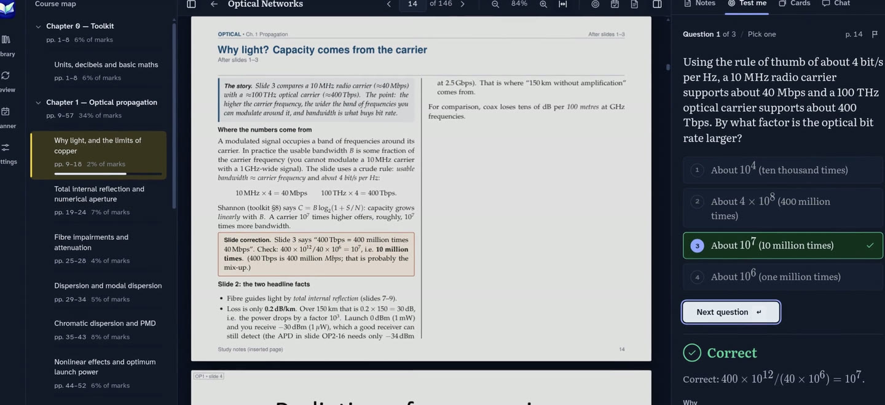
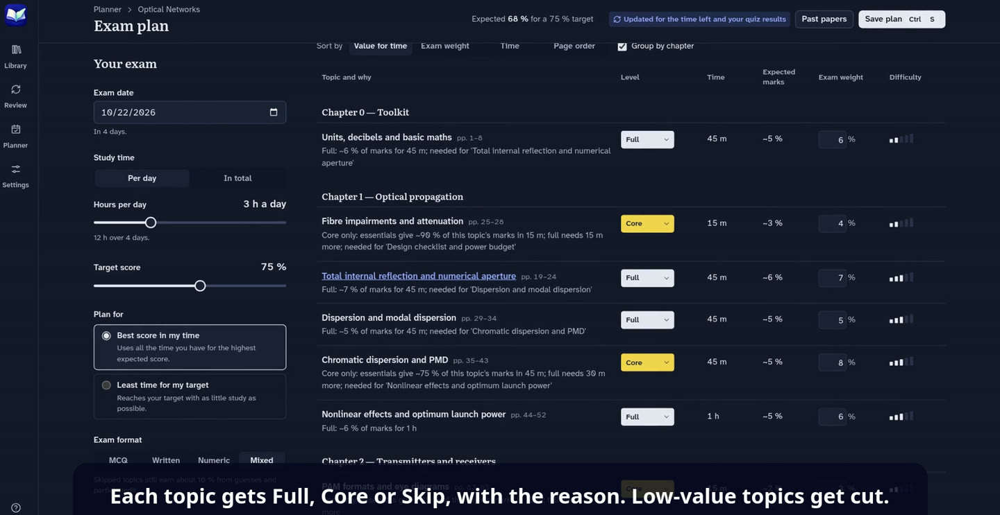
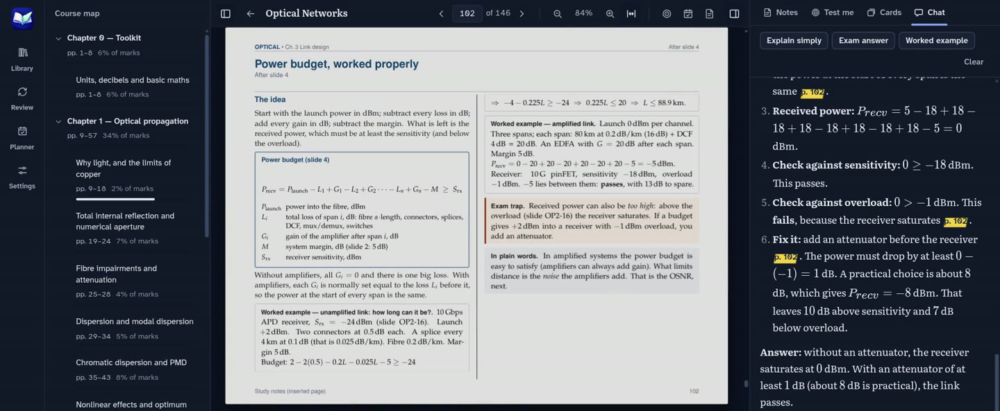
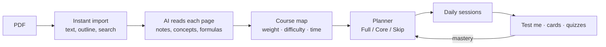

<p align="center"></p>

<h1 align="center">Study Buddy</h1>

<p align="center">
  <b>Turn theory-heavy PDFs into an exam plan you can actually finish.</b><br>
  Notes for every page · "Test me" on what you just read · flashcards timed to your exam · a planner that tells you what to skip
</p>

<p align="center">
  <a href="https://github.com/MykolaVaskevych/study-buddy/releases/latest"></a>
  <a href="https://github.com/MykolaVaskevych/study-buddy/actions/workflows/ci.yml"></a>
  
  <a href="LICENSE"></a>
  <a href="https://coderabbit.ai"></a>
</p>

<p align="center">
  
</p>

Students already ask AI to turn their lectures into study notes. That still leaves hundreds of pages and a few days. Study Buddy reads every page with you (slides, scans and formulas included), checks you on it, and plans the exam around the time you really have. If 100 % is out of reach, it aims for the 70–80 % that is.

## What it does

<table>
  <tr>
    <td width="50%"></td>
    <td width="50%"></td>
  </tr>
  <tr>
    <td><b>Import any PDF.</b> The AI reads every page in the background, image-only slides and formulas included. Today's sessions are waiting when you open the app.</td>
    <td><b>Read → test.</b> Finished a page? "Test me" asks a few questions on exactly that page, prepared in advance so it's instant, with the reason behind each answer.</td>
  </tr>
  <tr>
    <td></td>
    <td></td>
  </tr>
  <tr>
    <td><b>Honest exam plan.</b> Exam date, hours per day and a target score in; expected score, a day-by-day schedule, and "what it would take" out.</td>
    <td><b>Triage.</b> Every topic gets <i>Full</i>, <i>Core</i> or <i>Skip</i> with a reason, so long, hard, low-value topics stop eating your evenings. Past papers recalibrate the weights.</td>
  </tr>
  <tr>
    <td></td>
    <td valign="top">
      <b>Tutor that cites pages.</b> Ask anything about the book; every answer links back to the page it came from. One click for "explain simply", "exam answer" or a worked example.<br><br>
      <b>And also:</b>
      <ul>
        <li>flashcards with spaced repetition (FSRS), with decks shaped by your exam's format</li>
        <li>quizzes and timed mock exams with verified answer keys</li>
        <li>an AI-written study book, one chapter per topic</li>
        <li>a one-page cheat sheet, bookmarks and notes</li>
        <li>Anki export</li>
        <li>a guided tour on every screen</li>
      </ul>
    </td>
  </tr>
</table>

## How it works



Your quiz results feed back into the plan, so it re-solves as you go ("ahead: add X back", "behind: drop Y").

## Pick your AI

|                                                          | Cost                                                 | Setup                                                                                                                                       |
| -------------------------------------------------------- | ---------------------------------------------------- | ------------------------------------------------------------------------------------------------------------------------------------------- |
| **Claude subscription** (default)                        | Included in Claude Pro / Max                         | Install [Claude Code](https://claude.com/claude-code), then **Settings → AI connection → Sign in with Claude**                              |
| **ChatGPT subscription** (via Codex)                     | Included in ChatGPT Plus / Pro                       | Install [Codex](https://github.com/openai/codex) (`npm install -g @openai/codex`), then **Settings → AI connection → Sign in with ChatGPT** |
| **Anthropic API key**                                    | Pay per request, with an optional monthly budget cap | Paste the key in Settings; it's stored encrypted by your OS keychain                                                                        |
| **Local model** (Ollama, LM Studio, llama.cpp)           | Free, offline                                        | `ollama pull qwen3.6:27b` (24 GB GPU; `gpt-oss:20b` for less), start Ollama with `OLLAMA_CONTEXT_LENGTH=32768`, and pick it in Settings     |
| **Other OpenAI-compatible APIs** (DeepSeek, OpenRouter…) | That provider's prices                               | Pick the preset and paste its key                                                                                                           |

Switch between them from the status bar at any time, for example when your subscription hits its usage limit. Local models read the text of each page, so image-only slides are skipped.

## Install

Grab the latest build from **[Releases](https://github.com/MykolaVaskevych/study-buddy/releases/latest)**:

| Platform           | File                                                                                                           |
| ------------------ | -------------------------------------------------------------------------------------------------------------- |
| Linux (any distro) | `study-buddy.flatpak`: open it with Discover / GNOME Software, or `flatpak install --user study-buddy.flatpak` |
| Linux              | `.AppImage`, `.deb`, or `.pacman` (Arch: `sudo pacman -U study-buddy-*.pacman`)                                |
| Windows            | `Study Buddy Setup *.exe`. It's unsigned, so SmartScreen asks once: _More info → Run anyway_                   |

Check that the AI connection works with `study-buddy --check-ai`.

## Roadmap

- [ ] **Courses**: one subject, many files, with plan, review and tutor across the whole module ([#46](https://github.com/MykolaVaskevych/study-buddy/issues/46))
- [ ] **Import PowerPoint, Word, images and Markdown** ([#47](https://github.com/MykolaVaskevych/study-buddy/issues/47))
- [ ] **Create PDFs**: merge files into a course pack and export the AI study book ([#48](https://github.com/MykolaVaskevych/study-buddy/issues/48))
- [ ] Freehand ink and highlights on pages ([#38](https://github.com/MykolaVaskevych/study-buddy/issues/38))

## Development

```bash
npm install
npm run dev      # run the app with hot reload
npm run check    # typecheck + lint + format + tests
npm run smoke    # build and launch once with a fake AI
```

Electron + React + TypeScript, SQLite (FTS5), pdf.js, FSRS. Read [ARCHITECTURE.md](docs/ARCHITECTURE.md) for the layers and AI providers, and [OVERVIEW.md](docs/OVERVIEW.md) for the product story. To build packages yourself, run `npm run dist:linux` (output in `release/`).

## License

GPL-3.0-or-later. See [LICENSE](LICENSE).
